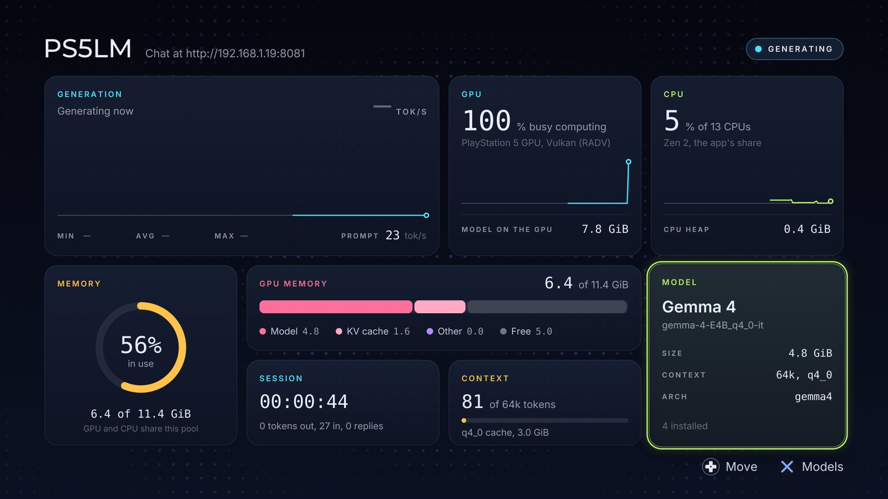
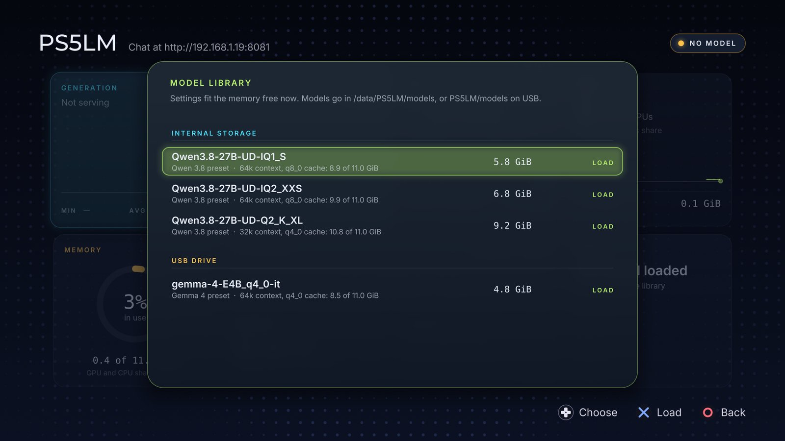
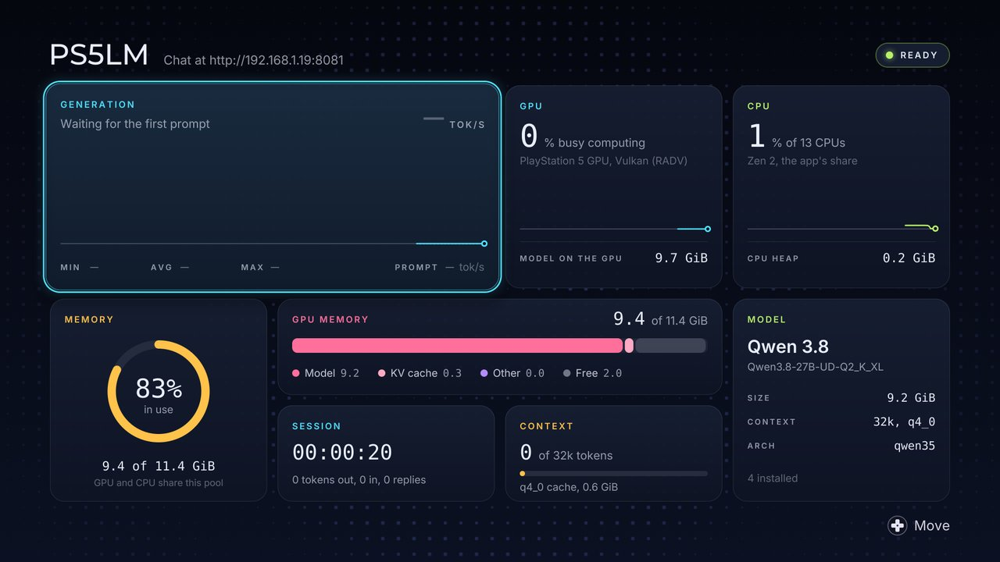

<p align="center"></p>

# PS5LM Plus

**llama.cpp on a jailbroken PlayStation 5, on its GPU.** A native app that runs GGUF language models on the console itself, with a dashboard on the TV, a model store, and a chat and OpenAI-compatible API for every device on your network.

> **This is a fork.** PS5LM was created by **[Mert Cobanov](https://github.com/cobanov)** ([cobanov/PS5LM](https://github.com/cobanov/PS5LM), [ps5lm.cobanov.dev](https://ps5lm.cobanov.dev)): the llama.cpp port, the payload, its model library and the research all come from there. This fork, by me, adds the **native GPU app**, named PS5LM Plus to tell it apart from the original, offered back upstream in [cobanov/PS5LM#12](https://github.com/cobanov/PS5LM/pull/12). The original payload's README is kept in [docs/PAYLOAD.md](docs/PAYLOAD.md).

<p align="center">
  
</p>

## What it does

A payload gets about 6 GiB of memory and no GPU. A native app (a title) gets the console's 12 GiB of direct memory and the GPU, so PS5LM Plus runs as one: llama-server with ggml's Vulkan backend on Mihawk-99's RADV port, in one 11.44 GiB device heap.

| Model (on the PS5 GPU) | Context | Generation |
|---|---|---|
| Qwen3.8-27B UD-Q2_K_XL (9.2 GiB) | 32k, q4_0 cache | 20.3 tok/s; a 7,775-token answer at 19.7 tok/s |
| Qwen3.8-27B UD-IQ2_XXS (6.8 GiB) | 64k, q8_0 cache | 20.7 tok/s |
| Gemma 4 E4B QAT q4_0 (4.8 GiB), from USB | 64k, q4_0 cache | 61 tok/s |
| Llama 3.2 3B Instruct Q4_K_M (1.9 GiB), from USB | 64k, q8_0 cache | 124 tok/s |

For comparison, the 27B on the CPU as a payload, streamed from disk, made about one token a minute.

<table>
  <tr>
    <td></td>
    <td></td>
  </tr>
  <tr>
    <td align="center">The model library at launch</td>
    <td align="center">Qwen 3.8 27B loaded: the plan and the arguments it runs with</td>
  </tr>
</table>

## Features

- **Dashboard:** generation speed with its history, GPU and CPU use, SoC power and energy per token, temperatures and fan, the memory pool and how the model, KV cache and the rest split it, context in use, storage on every drive, and the loaded model. Cross expands the USAGE, POWER and MODEL cards.
- **Model library:** every `.gguf` on internal storage, an M.2 drive or a USB drive, grouped by drive. Each shows the context and KV cache it would get and whether it fits; Cross loads it. A model on USB or M.2 loads straight from the drive.
- **Settings:** load a model at launch and which one, the longest context, the KV cache type, the chat's file tools and when to warn about their folder, sounds, and which drive downloads go to. Saved to `/data/PS5LM/settings.json`.
- **Logs:** `app.log` and `llama.log` on the TV, with an errors-only filter.
- **Get models:** Hugging Face's GGUF repositories, most downloaded or by family. Each file shows its size and whether it fits this console (Square checks one on demand, read from the first 16 MiB of the file). Cross downloads it.
- **Downloads:** a queue that survives a dropped connection, a pause and the app restarting. Each download resumes where it stopped, retries on its own, and shows speed and time left. Cross pauses or resumes, Square cancels. Files are checked against their SHA-256.

**Safety checks**

- Downloads check free space first (the file plus 1 GiB spare) and offer another drive when one has room.
- A download while a model holds the memory asks first, and can unload it for you.
- The chat's file tools are confined to `/data/PS5LM/scratch`, with a size warning and a Clear button.

**On your network**

<p align="center">
  
  <br><sub>The chat in a PC's browser, served by the PS5: Llama 3.2 3B on the console's GPU at 105 tok/s</sub>
</p>

- **Chat:** llama.cpp's web UI at `http://<console IP>:8081`, with file tools and, for vision models such as Gemma 4, images (put the model's `mmproj` file beside it).
- **API:** OpenAI Chat Completions and Responses, and Anthropic Messages, on the same port. opencode, codex, Claude Code and aider work against it: see [docs/CLI.md](docs/CLI.md).

**Under the hood**

- **Planner:** picks the longest context and the best KV cache type that fit the memory free, per model.
- **Presets:** sampling settings for Qwen 3.5/3.6/3.8, Gemma 4, gpt-oss, Granite, Nemotron, Mistral and Llama.
- **Sensors and storage:** a title may not read the temperature, fan or power sensors, or the real free space of a drive, so the app carries [ps5-exporter](https://github.com/Marice/ps5-exporter) and hands it to elfldr when it is not running.

## What you need

A jailbroken PS5, with these payloads loaded before you start the app:

| Payload | Needed for | |
|---|---|---|
| [kstuff-lite](https://github.com/EchoStretch/kstuff-lite) | the kernel patches homebrew titles run on | required |
| [etaHEN](https://github.com/etaHEN/etaHEN) | homebrew support (see the note below) | required |
| [ShadowMountPlus](https://github.com/drakmor/ShadowMountPlus) | registers PS5LM Plus from `/data/homebrew` on the home screen | required |
| [elfldr](https://github.com/ps5-payload-dev/elfldr) (port 9021) | lets the app start ps5-exporter: thermals, fan, power and real free space | strongly recommended |
| [ftpsrv](https://github.com/ps5-payload-dev/ftpsrv) (port 2121) | installing and updating the app, copying models from a PC | recommended |

ps5-exporter comes inside the app; you do not load it yourself.

## Install

1. Download `ps5lm-app-vX.Y.Z.zip` from the [releases](https://github.com/abhi245y/PS5LM-Plus/releases) and check it against its `.sha256`.
2. Unzip it and copy the `PPSA99581` folder to `/data/homebrew/PPSA99581` over FTP. ShadowMountPlus adds **PS5LM Plus** to the home screen.
3. Start PS5LM. Pick a model in **Get models**, or copy a `.gguf` to `/data/PS5LM/models`, to `/data/homebrew/PPSA99581/models`, or to `PS5LM/models` on a USB drive (exFAT) or the M.2 drive.
4. Choose the model in the library. Once the dashboard says Ready, open `http://<console IP>:8081` on a phone or computer.

To update, close the app and copy the new `PPSA99581` folder over the old one. Settings, models and downloads stay in `/data/PS5LM`.

A title sees only its own folder unless something opens the console's storage to it. On the console
PS5LM is developed on (13.00), ShadowMountPlus v1.7-beta5fix1 does so before the title starts, with
or without a HEN: its `debug.log` shows `[FAKELIB] directory mounted for PPSA99581: /data` (and
`/mnt/usb0`). OnionHEN does so on request: PS5LM asks when it starts
(`/download0/etahen_jailbreak`), which OnionHEN honours for a title on its app jailbreak allowlist,
so add `PPSA99581` to `app_jailbreak.exact_title_ids` in `/data/OnionHEN/config.ini`.

When storage stays closed, the first start says so, with the firmware, and asks which way to go:
get full storage (a current ShadowMountPlus, or the OnionHEN allowlist) and open the app again, or
go on in the app's own space. Then settings, the log and downloads stay in the app's own space,
`/download0` (over FTP: `/mnt/sandbox/PPSA99581_000/download0/PS5LM`), whose size is
`downloadDataSize` in `sce_sys/param.json`; models copied to `/data/homebrew/PPSA99581/models`
load too. USB and M.2 drives stay out of reach. An update that raises `downloadDataSize` grows the
space at the next start and keeps what is in it; lowering it frees nothing (tested on 13.00).
Uninstalling the app deletes the models in both places, so update by copying the new folder over
the old one.

Which models fit is in [docs/MODELS.md](docs/MODELS.md); anything llama.cpp runs works if the library shows LOAD.

## Controls

| Where | Button | Does |
|---|---|---|
| Everywhere | L1 / R1 | previous / next page |
| Dashboard | D-pad, Cross | move between cards, expand one; Cross on MODEL opens the library |
| Library | Cross | load the model under the cursor (the app restarts into it) |
| Get models | L2 / R2 | change the search (Popular, Qwen, Gemma, ...) |
| Get models | Square | check whether the file fits |
| Get models | Cross | open a repository; on a file, download it |
| Downloads | Cross | pause, resume, or try a failed one again |
| Downloads | Square | cancel (press twice; the partial file is deleted), or clear a finished one |
| Logs | Square, Triangle | switch log, errors only |

## How it was built

The full notes are in [docs/CONSOLE.md](docs/CONSOLE.md). In short:

- **CPU first:** Qwen 3.8 27B ran as a payload on the Zen 2 CPU, streamed from disk at about a token a minute: proof that llama.cpp works on the console, and that the GPU was needed.
- **A title, not a payload:** llama-server linked into an fSELF `eboot.bin` with a clean-room `libc.prx`, registered through ShadowMountPlus. Titles may not `exit()`, have some libc imports resolve to nothing, and need a working `getaddrinfo`, `accept4` and `HOME`; each was found by a crash.
- **The GPU:** ggml-vulkan on [PS5_Vulkan](https://github.com/mihawk-99/PS5_Vulkan)'s RADV with no Vulkan loader, and RADV's unified heap for 11.44 GiB in one heap.
- **The screen:** [ps5-homebrew-ui](https://github.com/blackbearreloaded/ps5-homebrew-ui) through ps5-opengl, in the same process as RADV (the two Mesa builds share 4,399 symbol names, so the GL stack is linked with only its API visible).
- **Switching models:** unloading in place leaves about 5 GiB of the pool held, so the app restarts itself for each switch.
- **HTTPS:** downloads use the system's own libSceHttp2 and libSceSsl, so the app carries no TLS library or certificates.
- **What a title cannot do:** read sensors, see real free space (`statvfs` in a title is a stub), or start processes. ps5-exporter, a payload, covers the first two.

## Building the app

The app links llama.cpp with ggml-vulkan against [PS5_Vulkan](https://github.com/mihawk-99/PS5_Vulkan)'s RADV build. Set up PS5_Vulkan and its forks in `.deps/src` (`PS5_Vulkan`, `PS5_Mesa` and `PS5_PayloadSDK` at the revisions PS5_Vulkan pins), then:

```sh
git clone --recursive https://github.com/abhi245y/PS5LM-Plus
cd PS5LM
(cd .deps/src/PS5_Vulkan && tools/setup-native-dependencies.sh && tools/build-radv.sh release && make app)
scripts/build-app.sh             # build/app-ps5/title/PPSA99581
scripts/release-app.sh           # build/release/ps5lm-app-vX.Y.Z.zip and its .sha256
```

From the PC, with the app on the console:

```sh
scripts/preview-app-ui.sh                       # render every screen to build/app-preview/*.png (Mesa, no console)
PS5_HOST=<console IP> scripts/ps5lm-app.sh cycle # close, deploy, launch; also close|deploy|launch
PS5_HOST=<console IP> scripts/ps5lm-app.sh press r1        # press a button on the console
PS5_HOST=<console IP> scripts/ps5lm-app.sh screenshot out.bmp
```

The app closes itself on request (`/data/PS5LM/quit`), so nothing is killed while it draws. Launching uses [ps5-homebrew-dev-protocol](https://github.com/blackbearreloaded/ps5-homebrew-dev-protocol)'s launch payload, cloned into `.deps/src`. `/data/PS5LM/app-args.txt` (one argument per line) overrides the planner.

| Path | What |
|---|---|
| `ps5/app` | the native app: dashboard, planner, store, downloads, llama-server on the GPU |
| `third_party/llama.cpp` | upstream llama.cpp, pinned as a submodule |
| `third_party/ps5-homebrew-ui` | the UI toolkit |
| `patches/` | PS5 changes to llama.cpp, kept small (tool confinement, Anthropic system messages, ...) |
| `ps5/compat`, `probes/` | the payload build's libc additions and memory probes (see [docs/PAYLOAD.md](docs/PAYLOAD.md)) |
| `scripts/` | build, release, deploy and console tools |
| `docs/` | [coding tools](docs/CLI.md), [models that fit](docs/MODELS.md), [console notes](docs/CONSOLE.md), [porting](docs/PORTING.md), [research](docs/RESEARCH.md), [plans](docs/plans) |

## Versions and branches

- Releases follow [semver](https://semver.org): tags `vX.Y.Z`, notes in [CHANGELOG.md](CHANGELOG.md), version set in `ps5/app/version.hpp` and shown on the dashboard. v0.1.x are upstream's payload releases.
- `main` is this fork's integration branch. Each feature is built on its own branch (`feature/...`, `docs/...`) and merged into `main`.
- `native-gpu-app` is the branch of the upstream pull request.

## Why llama.cpp

Earlier PS5 LLM work hand-writes GPU kernels for one model at a time. PS5LM ports llama.cpp itself, so every architecture and every quantization llama.cpp supports comes along: Qwen, Llama, Mistral, Gemma, from 1-bit to 8-bit.

## Credits

- **[Mert Cobanov](https://github.com/cobanov)**, who created PS5LM ([cobanov/PS5LM](https://github.com/cobanov/PS5LM)): the llama.cpp port to the PS5, the payload and its library, the build scripts and the research this fork builds on.
- [llama.cpp / ggml](https://github.com/ggml-org/llama.cpp), which does the actual work.
- [PS5_Vulkan](https://github.com/mihawk-99/PS5_Vulkan) (Mihawk-99) for RADV on the PS5, and [ps5-homebrew-ui](https://github.com/blackbearreloaded/ps5-homebrew-ui), [ps5-opengl](https://github.com/blackbearreloaded/ps5-opengl) and ps5-homebrew-dev-protocol (BlackBearReloaded) for the app's screen and tooling.
- [ps5-exporter](https://github.com/Marice/ps5-exporter) (Marice) for the sensors and drive space the app shows.
- [ps5-payload-dev](https://github.com/ps5-payload-dev) (John Törnblom) for the SDK, the ELF loader, ftpsrv and klogsrv.
- [PS5SX2](https://github.com/Swordpdf/PS5SX2), [ProsperoAI](https://github.com/blackbearreloaded/ProsperoAI) and [PS5_Vulkan](https://github.com/mihawk-99/PS5_Vulkan), whose notes on the console's memory and GPU this project leans on.

## Licence

GPL-3.0-or-later, see [LICENSE](LICENSE). llama.cpp keeps its MIT licence. No Sony SDK files, keys, firmware or model weights are in this repository.

PS5LM Plus is not affiliated with Sony Interactive Entertainment or Alibaba. "PlayStation" and "PS5" are trademarks of Sony Interactive Entertainment.
